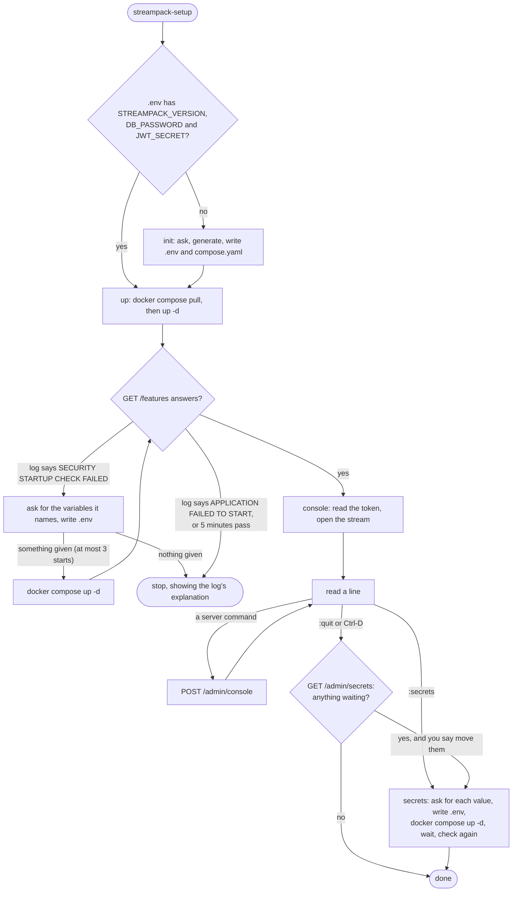

# How a Run Goes

`streampack-setup` with no command does three things in order: `init` if the directory isn't configured yet, then `up`, then `console`. Each is also a command of its own, and every run can be repeated: a step that's already done is skipped.

## `init`

`init` reads `.env` if there is one, and asks only for what it lacks, so running it on a configured directory asks nothing.

1. **The server version.** It suggests the newest tag in the image registry. If the registry can't be reached, it says so and asks with no default.
2. **The super-admin's email address, the API's public address and the site's public address.** Each is checked: an email address, and addresses that start with `http://` or `https://`.
3. **Generated values:** the database password, the JWT secret and GitHub's webhook key. They're random, made on this box, and never shown.
4. **Which integrations to turn on.** Mattermost and GitLab default to yes, IRC, Slack and Discord to no. GitLab gets a generated webhook key. Discord's three values are asked for straight away, because the server needs them before it starts. The others need nothing yet.
5. **Mail.** If you want it: the SMTP host, port, sender, and optionally a username and password.
6. **The files.** It writes `compose.yaml` if there isn't one, and never overwrites one that's there. It makes the `generative/` directory, and writes `.env` with mode 600.

Nothing is sent anywhere during `init`, except the registry lookup for the version.

## `up`

1. `docker compose pull`, then `docker compose up -d`.
2. It polls `GET /features` every 2 seconds until the server answers. Between polls it reads the last 300 lines of the server's log, looking for a start that was refused.
3. **A refused start.** The server's secrets check refuses to start when a credential stored in the database has no environment variable, and its log names those variables. `up` shows that part of the log, asks for each variable (hidden), writes the answers into `.env`, and starts the server again, at most three times in all. Any other startup failure, or no answer within 5 minutes, stops `up` with the log's explanation.

## `console`

1. **The stream.** It opens the server's console stream (`GET /admin/console/stream`) as the super-admin. The server's first event names the account, and the tool prints "Console open as …".
2. **The token.** The tool reads it with `docker compose exec server-streampack cat /run/streampack/admin-token`. The server writes that file inside its own container once it's ready, and renews it. When a request comes back 401, because the token has been renewed or the server restarted, the tool reads the file again and retries once.
3. **The input loop.** Each line you type is posted to `/admin/console`. The answers come back on the stream, so a slow command's answer can arrive after the next prompt. When the stream drops, the tool says so once and reopens it every 2 seconds. Anything the server said in between is lost.
4. **Its own commands** start with `:`. `:secrets` moves credentials now, `:help` lists the commands, and `:quit` or Ctrl-D leaves.
5. **Leaving.** The tool stops the stream, then asks the server whether any credentials are still waiting. If some are, it offers to move them. Against a server too old to answer, it just leaves.

## `secrets`

1. **What's needed:** `GET /admin/secrets` returns each variable's name and what it's for. Values never come back.
2. **The values.** The tool asks for each one, hidden. A blank answer skips it.
3. **`.env`.** It writes the answers into `.env`.
4. **The restart.** It runs `docker compose up -d`, which recreates the container. A `restart` would keep the old environment. On this start the server finds each variable set and replaces the stored value with an `env://` reference. It doesn't compare the two, so from then on the value in `.env` is the one used, even if it was mistyped.
5. **The check.** It waits for the server, then asks again and reports anything still needed.

[Why It's Built This Way](design.md) covers the choices behind these steps.
